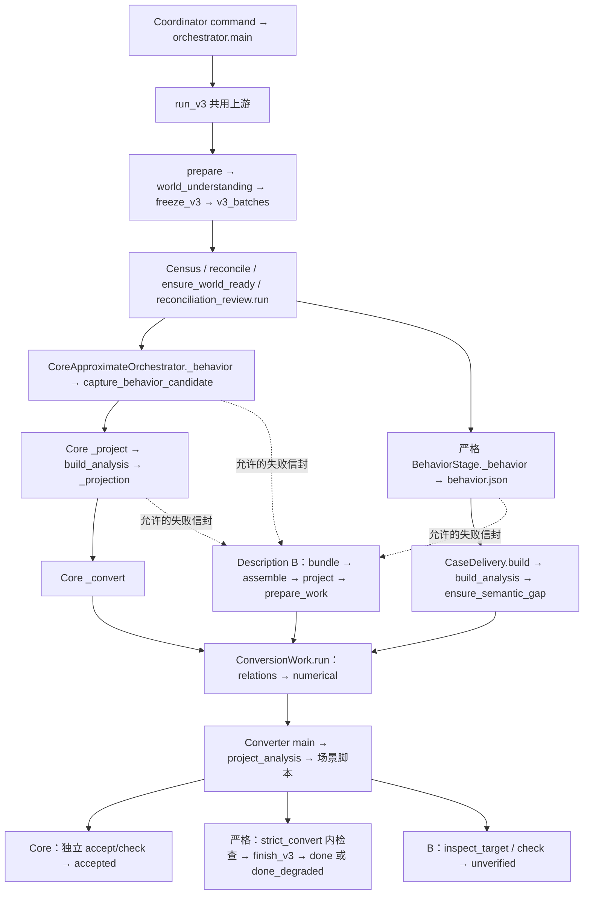

# 当前新 v3 代码阅读地图

函数定位基于工作树源码，案例数值来自各自保存的产物。原审计可参见 [11/02 全链路地图][audit-chain]、[11/04 事实追踪][audit-fact] 和 [11/05 Converter 追踪][audit-target]。

先沿 7916ef73 正向读一遍。后面的分支图和函数表用来查入口与职责，c2042c33 单独作为历史合同对照。

## 1. 7916ef73 从原视频到 Core Target

```text
视频 → Case 与采帧 → World → Batch 与事实裁定 → Behavior 候选
     → 完整观察 Analysis → Core Analysis → 关系与数值方案 → Target 与 Core 验收
```

下面的原 Case 是 `case_20261027T034536473Z_7916ef73`。从 Core 投影开始，执行 Analysis、转换请求和方案写在 `core_approximate_deliveries/<Case ID>/cases/<Case ID>/`，最终 Target 和验收 manifest 在同一交付根的 `approximate_output/`。

### 1.1 入口、视频绑定与采帧

`process.command()` 先收视频路径和参数。`select_default_workflow()` 仅在未指定版本、未指定 v3 专用模式且没有 `--case-id` 时按时长选版本。本例日志记录约 **10.04s**，超过 **2.1s** 阈值，选 v3。新建 v3 默认补 `--core-scene-approximate`，显式 `--strict-delivery` 选择严格路径。Coordinator 转发视频绝对路径、参数 JSON、`--new` 和 Core 标志，`orchestrator.main()` 校验后进入 Core 的 `select_case()`。恢复时改传 `--case-id`，从保存的模式补 Core 标志，空参数 JSON 由编排入口读回 `case.json.parameters`。恢复沿用冻结版本，不按时长重选。见 [Coordinator][entry]、[编排分派][dispatch] 和 [本例启动日志][7916-start]。

新建由 `Cases.bind(force_new=True)` 计算视频 SHA-256，用 UTC 时间戳和 `SHA256(视频 SHA 字符串 + 创建时间)` 的八位前缀组成 Case ID。`case.json` 保存内容 SHA、大小和规范化参数，`state/binding.json` 保存实际视频绝对路径和预期 SHA。`run_v3()` 在 `planning` 才调用 `prepare()`。它先重验视频 SHA，同目录下若 `probe.json` 和 `global_frames.json` 都在就直接读回。恢复从 Batch 或 Behavior 接续时跳过采帧。见 [绑定代码][bind]、[本例 Case 记录][7916-case]、[视频绑定][7916-binding] 和 [采帧入口][prepare]。

`prepare()` 将源帧的真实 PTS 减去首帧 PTS，从每 **0.5s** 的目标时刻选最近的真实帧，并保留首尾、去重。本例的 `10.0s` 和容器终点 `10.041667s` 都选中源索引 `240`。选中的源索引 `0、12、…、240` 按输出顺序写为 `frame_0001.png` 至 `frame_0021.png`，`probe.json` 保留实际时刻 `0.0–10.0s` 和单独的容器时长。全局选帧再合并均匀采样和画面变化较大的帧，显式保留首尾。本例 **21 张探测 PNG → 10 张全局 JPEG**。见 [采帧与全局选帧][prepare] 和 [本例 probe][7916-probe]。

### 1.2 World 请求与初始 Registry

`WorldStage.world_understanding()` 调用 `single_world.packet()`，将全局帧表中的 `frame_id/time_s/JPEG 路径/SHA` 和响应 Schema 写入 `world_observation.request.json`。首帧 `frame_0001 / 0.0s` 在十张 JPEG 里。Worker 的读取范围是冻结请求和 `frames` 列出的图片，`access_enforcement=prompt_only` 表示这是任务指令约定。候选编译独立执行硬校验，`compile_world()` 核对请求哈希，`validate_initial()` 按请求帧表检查结构化帧引用。比如探测目录中存在的 `frame_0002 / 0.5s` 没进入 World 请求，用它作 `first_seen_frame_id` 会被拒绝。见 [World 任务包][world-packet]、[帧引用门禁][world-reference] 和 [本例冻结 World 请求][7916-world-request]。

World Worker 在 `actor_hypotheses` 提出首见、车型和车道。`actor_003` 是 `frame_0001` 正前方中间道 `lane_002` 的白色挂车尾部，`actor_004` 是同帧画面右缘、行驶车道外的铺装路肩上局部入画的白色牵引车头，车道留空。两者车型都写 `truck`，靠同帧位置和可见部位区分。Python 校验帧、Schema、Actor 唯一性和车道引用，补上该帧 `time_s=0.0`，再接纳 World。已接纳快照的 `actor_hypotheses` 由 `v3_batches()` 复制为首批前序 Registry。见 [原始 World 候选][7916-world-candidate]、[已接纳 World 快照][7916-world-snapshot] 和 [Registry 初始化][batch-registry-init]。

### 1.3 Batch、Census 和事实裁定

本例 `batch_0001` 的模式是 `lane-layout-review.v1`。Worker 独立观察布局，`adopt()` 核对请求与帧后，由 Python 把前序 Registry 原样写成 `registry_after`。这份列表就是 Batch 2 的前序 Registry。Batch 2 的 Worker 在 `frame_0001` 提出 `f1_v2 → actor_003`、`f1_v1 → actor_004`。`adopt()` 检查 Registry 的历史身份锁、Census 的帧时刻、前序 Actor 是否存在、同帧是否重复绑定。`f1_v2` 正在 `actor_003` 的登记首见帧，原候选和正式 Batch 中均为 `existing`。同帧 `f1_v5` 则保留 `unresolved`、`actor_id: null` 和候选 `actor_006`。`vehicle_census.normalize()` 还可以撤回早于登记首见的绑定，时间门禁会延迟长间隔且有竞争身份的关联。见 [Batch 1 透传代码][batch-layout-adopt]、[Batch 1 结果][7916-batch1]、[Batch 2 前序 Registry][7916-batch2-registry]、[Batch 2 同帧清点][7916-batch2] 和 [Census 接纳][census]。

`WorldReconciliation.reconcile()` 读取已接纳 Batch 和 World 快照，定向核验由 `close_lane_layout()`、`world_adjudication.run()` 承接，已接纳结果用 `commit_world_closure()` 提交事实版本。本例后续由 World 裁定将 `actor_002` 归到规范身份 `actor_003`，Behavior 使用事实版本 `v000001-ce97617f4946`。这是首帧 `f1_v2` 已绑定 `actor_003` 之后的裁定。见 [Reconciliation][reconcile]、[事实提交][versions] 和 [本例 Census 凭证][7916-census]。

### 1.4 Behavior 候选与来源绑定

`evidence_timeline()` 以有效 Registry 和已接纳 Census 的规范 ID 为准，将 Batch 原文按 Actor 和帧分组。`batch_0002#/vehicle_census/0/vehicles/1` 是对象原文的位置，`actor-frame:actor_003:frame_0001` 则是 Behavior 点的 `source_observation_ids` 引用。`validate_source_coverage()` 会拒绝未知 ID，或 Actor、帧、已填写时刻对不上的引用。必需来源组要由轨迹点、匹配事件或明确的未决限制承接，只写 `detail` 不构成覆盖。另有一条受限的来源修订路径，`source_revision.apply()` 在获准撤回无来源 Ego 点时，可把同帧其他车辆的已绑定原文留成 `source_revision_qualitative`，供后续 `semantic_motion.evidence()` 复验并标为 `qualitative_only`。见 [证据时间线][timeline]、[来源门禁][source-coverage]、[定性来源修订][source-revision] 和 [本例冻结 Behavior 请求][7916-beh-request]。

`_run_selected()` 调 `run_v3(..., stop_after_behavior_candidate=True)`。共用流程执行到 `self.behavior(case)` 时，Core 覆盖的 `_behavior()` 把接纳回调换成 `capture_behavior_candidate()`，保存候选 SHA、会话、请求 SHA 和事实版本。严格路径在这里写 `state/behavior.json`。Core 在候选处返回，7916ef73 原 Case 停在 `aggregating`，没有正式 `behavior.json`。投影读的是回执指向的 `behavior.f564eed9…394d.json`，`_candidate()` 先复核已完成任务、候选字节、活动请求和事实版本。见 [共用流程的停点][v3-stop]、[Core 捕获回调][core-capture]、[归档复验][core-candidate] 和 [本例候选回执][7916-progress]。

### 1.5 完整观察 Analysis 与 Core Analysis

`_project()` 在隔离 Case 里用绑定候选和有效 World/Registry 准备内存中的 Behavior，检查编译合同、动作连续性和 Census 处置，再调用 `build_analysis()` 写 `inputs/full_observation_analysis.json`。Builder 内部的 `delivery_behavior` 是经过证据校验、展开未知值理由的内存副本。`build_analysis()` 复制 World 底稿，再从 Behavior 拆出 `ego/actors`，复制事件和限制。本例完整观察有 **7 个 Actor**。见 [Core 投影入口][core-project]、[Builder 组装段][first-read] 和 [本例完整观察 Analysis][7916-full]。

`required_actors()` 从 Ego 出发，保留动作依赖和有持续已知车道轨迹的车辆，本例包括 `actor_001`、`actor_003`。`required_background_actors()` 还会保留排除凭证不足的背景车辆。本例 `actor_007` 虽标为远处短暂背景，但它的唯一轨迹帧缺少对应的已观测 Batch 来源组，所以也保留。`_projection()` 从完整副本生成隔离的 Core `final/analysis.json`，只保留这 **4 个 Actor**。回执记录了 `actor_004` 的边缘局部车辆处置和 `actor_005/006` 的隔离对向处置。Census 另有 **29 条**观察排除，首帧 `batch_0004:frame_0001:obj_03` 仍为 `needs_evidence`，保留为未分配观察。Core 保留 Ego 的 **1.5–4.5s、`lane_002 → lane_003`** 左变道。来源、动作、Analysis 合同及 Converter 预检通过后才冻结转换请求。见 [必需车辆规则][core-required]、[背景保留规则][core-background]、[本例投影回执][7916-projection] 和 [Core Analysis][7916-core-analysis]。

### 1.6 ConversionWork 的关系与数值

`_convert()` 读取隔离 Core Analysis，以其 SHA 冻结 `conversion_semantic_gap.request.json`。本例请求有 `bounded_execution.v1`、`motion-witnesses.v1` 和 **74 项**文字来源。`finish_stage()` 合并程序处置和候选结果，最终 42 项为 `program_verified`、1 项为 `unobserved`。其余 31 项由关系阶段候选处理，30 项用于关系，1 项流程提示标为 `no_motion`。本例冻结的车身见证约束和程序关系都是空数组，四条实际车辆关系都来自 `save_0003.json`，包括 Ego 接近 `actor_003`（0–5s）、并行（5–10s），以及 `actor_003` 和 `actor_001` 各自的前方区间。`check_relations()` 按车辆的纵向位置差验收这些关系。`body_progress` 则需要相应的冻结来源与部位约束。见 [转换请求构建][request-core]、[本例冻结请求][7916-conversion-request]、[关系存档][7916-relations] 和 [关系数值检查][relation-check]。

数值阶段的 `workflow.json` 标为 `program_generated: true`。`bounded_execution.plan()` 根据已接纳关系搜索，选中 Ego、`actor_001`、`actor_003`、`actor_007` 分别以 **80、80、72、80 km/h** 恒速，初始纵向位置 **0、20、20、200m**。这些是仿真近似。搜索验收全员覆盖、时长、恒速、数值上限、已知值保留、车辆关系、同车道间距及变道走廊。`validate_committed()` 重放两阶段检查点并比对正式 `conversion_semantic_gap.json`，通过后才进入 Converter。见 [程序搜索][planner]、[检查点复验][work-committed] 和 [本例两阶段记录][7916-work]。

### 1.7 Converter 生成 Target，Core 独立验收

Converter 读取 Core Analysis、冻结策略和正式数值方案。`project_analysis()` 先给私有副本补路长、宽度，再应用运动计划。本例回执把 **300m** 记为 `road_length_policy_default`，按冻结默认值选取，`_roads()` 不用速度和时长计算路长。高速脚本的 `apply_highway_lane_change()` 从顶层 `events`、Ego 轨迹和车道拓扑重建变道规格，再用执行速度与宽度生成三段动作。本例 Target 在 **1.5–4.5s** 从 `Lane_2` 向左进入 `Lane_1`，两车道的执行宽度都是 **3.5m**，横向执行速度 **4.2 km/h**。变道的前后车道和观测窗口来自证据，连续横移和速度由执行方案给出。见 [投影顺序][projection]、[变道动作生成][motion]、[本例转换回执][7916-conversion-result] 和 [Target][7916-target]。

独立 `accept_core_approximate_target.py` 复验来源与投影、冻结请求和方案、Converter 回执及 Target 检查。本例 manifest 记录左变道和连续碰撞包络通过，`render_verification: not_executed`，`strict_validate_completed: not_claimed`。原 Case 的 `aggregating` 是共用流程停在 Behavior 候选后的状态，Core 交付结果在独立目录。见 [Core 独立验收][core-final] 和 [本例验收 manifest][7916-manifest]。

## 2. 通用分支图

[Coordinator `process.main → command`][entry] 转发至 [`orchestrator.main`][dispatch]。未指定版本的新视频先由 `select_default_workflow` 读时长：`0 < duration ≤ 2.1s` 自动 v2，其余 v3；显式版本及已有 Case 优先。**`--new` 的 v3 默认 Core；仅传 `--video` 不满足同一默认条件。** `--strict-delivery` 选严格路径，恢复沿冻结模式。



图中 Core/严格由入口预先选定，并非都执行。真正调用次序见 [`run_v3:648–685`][v3-loop]：Core 复用上游，但通过覆盖 `_behavior` 和 `stop_after_behavior_candidate=True` 在候选处返回；严格分支继续 `build`，由 `strict_convert` 调用 Converter 并检查结果。Census 嵌在 Batch 接纳和后续裁定中，不是每次必调的独立模型阶段。

**B 的分支点在外层** [`orchestrator.main:1734–1755`][b-dispatch]：原路径返回失败信封后，自动 B 模式且 `eligible_failure(result)` 为真才进入。Core 只接受 `core_noncore_scope_evidence_insufficient` 或 `identity_evidence_insufficient`；传输、代码变化、输入变化不走 B。B 重新绑定归档候选和已接纳来源，构建自己的 Analysis，并非复用 Core 执行副本。它与 Core 共用下游转换能力，交付等级不同。

## 3. 关键函数：输入、决定、输出、检查方

链接定位当前源码；同格中的箭头表示实际连续调用。Core 简写指 `runtime/core_approximate_delivery.py`，B 指 `runtime/description_fallback.py`；`_project/_convert` 是模块函数，Core 的 `_behavior` 属于 `CoreApproximateOrchestrator` 类。路径中的 `state/`、`final/` 均相对于所属 Case。

| 实际函数 | 读什么 | 决定什么 | 写/返回什么 | 谁接收并检查 |
|---|---|---|---|---|
| [`process.select_default_workflow / command`][entry] → [`orchestrator.main`][dispatch] | 视频、参数、冻结模式 | 版本、Core/严格及恢复入口 | 转发参数、最后的机器信封 | orchestrator 校验参数；Coordinator 展示对应 Case 结果 |
| [`case_core.prepare`][prepare] | 绑定视频、参数 | 真实帧时刻、采样和打包 | probe、global_frames、帧/JPEG | World request 及 `freeze_v3` 校验来源/哈希 |
| [`WorldStage.world_understanding → admitted_world`][world] | 冻结图片/request；`single_world.packet` 的任务包 | 编译视觉答案，检查 World 结构、证据、初见身份和布局 | 原始 `world_context.candidate.json` → 接纳 `state/world_context.json`，附编译回执 | `freeze_v3` 固定快照；后续 reconciliation 复验 |
| [`freeze_v3 → BatchLifecycle.v3_batches`][batch] | 已接纳 World、问题、图片、前序 Registry | 分批；逐批检查问题覆盖、帧、身份保留和冲突 | manifest/request；隐藏 candidate → `batches/batch_*.json`、累计 Registry | 下一批读取已接纳 Registry；reconcile 消费已接纳批次 |
| [`vehicle_census.normalize / defer_ambiguous_temporal_links / validate`][census] | Batch 每帧对象及绑定、前序身份 | 身份证据是否合法，哪些关联仍未决 | Batch 内规范化 Census / unresolved；不凭猜测强绑 Actor | Batch 接纳；`world_adjudication` 定向裁定；Behavior 前 `require_resolved(...allow_scope_pending=True)` |
| [`WorldReconciliation.reconcile → reconciliation_result → reconcile_world`][reconcile] | 冻结 World、已接纳 Batches | 合并已举证事实，识别布局/身份冲突 | `state/reconciliation.json`、待提交 World，或 needs_review | `close_lane_layout` / `ensure_world_ready`；未决不能当确认 |
| [`close_lane_layout → world_adjudication.run`][closure]；[`commit_lane_layout → fact_versions.commit_world_closure`][versions] | 定向 layout/Census 证据、父凭证 | 联合裁定是否可接纳、提交是否与父版本一致 | candidate → accepted certificate、commit journal、fact version | `ensure_world_ready`；[`reconciliation_review.run`][alignment] 对齐 Actor-time 来源，必要时定向点审并复用版本提交 |
| [`BehaviorStage._behavior` 内 `prepare → check → adopt`][behavior]（严格） | 冻结 request、当前 World/Registry、时间线/Census read view、原 candidate 或授权 patch | 规范化并检查身份、轨迹、事件、来源、scope、事实版本 | 通过后 `input_binding.write_behavior` 写 `state/behavior.json` 及接纳凭证 | [`execution_scope.inputs/project`][scope] 重验并提供执行输入；`CaseDelivery.build` 接收 |
| [`Core._behavior → capture_behavior_candidate`][core-capture] | 同类冻结请求、producer/session、完整 candidate/授权 patch | producer 终态、请求和来源覆盖是否合法 | `diagnostics.core_approximate_candidate` 绑定记录；**不提交严格 behavior.json** | Core `_project` 再做编译、范围、来源、核心动作检查 |
| [`CaseDelivery.build`][build-save] → [`contracts.v3.build_analysis`][builder]（严格） | `execution_scope.inputs` 给出的 World/Behavior、参数、probe、执行缺口 | 将静态世界与动态行为组装，判断交付状态 | 内存 Analysis/status；build 验证后保存 `final/analysis.json`，needs_review 也可能保存 | `validate_analysis`、`validate_analysis_motion`、版本检查；可选 [`reconcile_analysis`][analysis-reconcile] 只做受限文字补充，再交转换 |
| [`Core._project`][core-project] → `build_analysis → _projection` | bound candidate、有效 facts、Census/scope、必需 Actor | 完整观察如何投影为核心执行场景，来源是否全部处置 | `inputs/full_observation_analysis.json` → 独立 Case 的 `final/analysis.json` + projection receipt | `validate_analysis_motion`、`strict_v3_preflight`、`semantic_motion.request`；最后独立 Core 验收 |
| [`Description B._bundle → _assemble`][b-bundle] | 归档完整候选、已接纳 World/Registry/Census、帧与参数 | 来源全部终态且绑定；复用 prepare/build 组装完整观察 | `source_bundle/source_receipt` → `inputs/full_analysis.json` | `_bound` 重验来源；[`_project → description_draft.project`][b-project] 检查核心事实及来源处置 |
| [`B._project → _prepare_work`][b-work] | B full Analysis、源 bundle | 保留执行对象、身份选择、未建模风险及核心动作 | B 独立 `final/analysis.json`、projection receipt、冻结 request | `require_core_scene` 与 ConversionWork；旧 Analysis 的 scope/bounded 凭证不能直接搬过来 |
| [`CaseDelivery.ensure_semantic_gap`][request-strict] / [`Core._convert`][request-core] / B `_prepare_work` → [`semantic_motion.request`][request] | 本分支 Analysis + SHA、冻结 policy | 动作支持、身份门禁、请求版本和数值权限 | `state/conversion_semantic_gap.request.json` | ConversionWork；请求绑定的是该份 Analysis，不是任意同名文件 |
| [`ConversionWork.run → run_stage → collect → finish_stage`][work] | 冻结请求、累积 save、已接纳 checkpoint | 先关系/来源全覆盖，再数值；能程序完成则复用程序规划 | `save_NNNN.json` 候选 → `accepted/<digest>.json` + workflow → `conversion_semantic_gap.json` 正式方案 | `finish_stage/validate_committed` 全量重验；Converter 消费正式方案 |
| [`Converter main`][converter] → [`project_analysis`][projection] → highway/intersection 脚本 | Analysis、hash 绑定 policy、正式转换方案 | 只在执行副本补允许缺值，编译目标对象和动作 | 临时 `.projected-analysis-*` → 暂存 Target；检查后原子发布 `target.json` + `conversion_result.json` | `mela_valid`、`validate_target` 检查 Schema/引用、来源、动作、连续运动/碰撞；不反写 Analysis |
| [`strict_convert / finish_v3 / validate_completed`][strict-final]；[`Core accept.prepare/run`][core-final]；[`B._inspect_target/check`][b-final] | Target、来源/投影/转换回执、事实版本 | 各自交付门禁与重放是否通过 | 严格正式 artifacts；Core 独立 accepted manifest/report；B 固定 unverified manifest | 各分支最终检查；没有真实 runner 就仍是 `render_verification=not_executed` |

**三个数据层不能混读：** `*.candidate.json` 和 ConversionWork `save_*` 是原始/待验候选；`state/world_context.json`、严格 `state/behavior.json`、accepted 凭证是所属阶段的接纳结果；scope 投影、Core/B 隔离 Analysis、Converter 临时 Analysis 是各自用途的执行副本。Core/B 的 `full_*analysis` 是完整观察的构建结果，也不自动等于严格验收通过。Core `accepted`、严格 `done_degraded`、B `unverified` 必须分别统计。

## 4. 历史合同对照：c2042c33 的 Ego 变道

Case：`case_20261013T172904544Z_c2042c33`。它有原始观察、正式 Behavior/Analysis、冻结转换请求和 Target。下列都是该 Case 的实际数据摘录，没有借用其他 Case 的 Actor 编号。

| 接力点 | 实际数据 | 转接依据 |
|---|---|---|
| [Batch 2 原始观察][case-batch] | 1.5s 中间道；3.5s 最左道；原文“变道完成区间仅能约束在 (1.5,3.5]” | 这是该批采样边界；World/布局已确认 `lane_002` 中间、`lane_003` 最左 |
| [Behavior event_001][case-behavior] | before=`frame_0004 / 1.5 / lane_002`；after=`frame_0007 / 3.0 / lane_003` | Behavior 使用有效输入中的 3.0s 帧，将观察窗口收窄；不是精确测出的转向起止 |
| [Analysis event_001][case-analysis] | 同一个完整事件；Ego 11 个轨迹点的 `frame_id/time_s/lane_id/detail` 均保留 | `build_analysis:1356–1375` 复制动态域；不是另做一次视觉理解 |
| [冻结转换请求][case-request] | `analysis_sha256` 绑定原 Analysis；同一事件；`constant_speed_actor_ids=["ego"]` | `semantic_motion.request:232–244` 从 Analysis 推导变道 spec、保留事件并约束执行规划 |
| [ConversionWork workflow][case-work] → 正式方案 | relations 和 numerical 均 `complete=true`，最终 `sequence=4` | save 通过检查后才形成正式 `conversion_semantic_gap.json` |
| [Target][case-target] | `direction="left"`，`start_lateral_velocity=8.4`，目标 `Road_1_Seg_1_Lane_1`，结束时刻 `3.0` | highway 脚本 `:757–759` 调 [`apply_semantic_motion / apply_highway_lane_change`][motion] |

事件摘录（Behavior、Analysis、请求中完整事件对象实际相等）：

```json
{"event_id":"event_001","event_type":"lane_change","involved_actor_ids":["ego"],"time_range_s":[1.5,3.0]}
```

```text
观察：lane_002（中间）→ lane_003（最左）
Target：Lane_2 → Lane_1
0–1.5s drive_straight → 1.5–3.0s lane_change(left) → 3.0–10.041667s drive_straight
```

编号变化来自 [`lane_change.lane_names`][lane-names] 对 road.lane_ids 反向枚举，物理左右一致。8.4km/h 横向速度来自执行宽度与窗口：`8.4/3.6 × 1.5 = 3.5m`；3.5m 宽度和110km/h纵向速度属于执行近似，不能说是视频测量。

**历史合同边界：** 该例通过显式 `core-scene-approximation.v1` 范围凭证继续，原进度为 `done_degraded/source_contract_validated`；不是当前默认独立 Core 成功案例。[历史策略][case-policy] 的 Behavior scope 是 v3，缺少 timeline/alignment/fact_versions、bounded_execution、analysis_reconciliation；[当前新 Case][new-policy] 分别冻结 scope v4、`actor-time-evidence.v1`、`reconciliation-alignment.v1`、`case-facts.v1` 及后两项。历史转换请求没有 `source_witness_revision`；当前首次请求按策略条件冻结 `motion-witnesses.v1`，当前 B 也会在发现车身定性约束时启用它，旧请求不补写升级。

历史转换里，Ego 的 **110 km/h** 来自数值候选，前后速度节点相同以满足恒速要求。关系阶段将 Ego 与 `actor_001` 的接近和并行变成相对位置约束，允许多组绝对速度。末帧 Ego 中心领先约 1m，按策略车长两车仍有纵向重叠。旧合同的 `alongside` 容差上限是 10.5m，`overtakes` 的终点净空条件从 9.5m 开始，两者存在重叠。该例的车身引文没有 `source_observation_ids` 和 `source_revision_qualitative`，走普通关系引用。当前请求若启用了 `motion-witnesses.v1` 并生成 `completion: in_progress` 的部位约束，则还会检查整车在窗尾是否已经越过。见 [关系条件][relation-check]、[部位验收][body-witness] 和 [11/05 审计][audit-target]。

历史审计还发现 300m 路段不足以容纳 c2042c33 的全时窗运动。该例的静态路网检查与运动验收没有比较积分后的位置和路尾，真实渲染状态为 `not_executed`。[路长覆盖审计][audit-target]

## 5. 两个已有辅助流程

**默认路径 / 执行近似在哪里触发：**

- 入口的“默认 Core”只选交付分支。严格路径另由 [`routing.select_route`][routing] 先尝试 full；不足时，只有已授权 preview、单一路高速、路网/动作受支持、剩余缺口符合尺度条件，才选 straight_preview。`straight_preview.enabled=true` 不是强制走预览。
- [`ConversionWork.run_stage:474–499`][work] 仅在请求有合法 `bounded_execution` 且本阶段尚无 runs 时尝试程序接管。关系必须覆盖全部 evidence；数值由 [`bounded_execution.plan`][planner] 有界搜索并按相同门禁验收。缺证书/未覆盖语义不会自动被当作默认值；B 也不必然继承原 Case 的程序规划资格。
- [`project_analysis`][projection] 在 Converter 私有副本应用冻结权限，逐字段记录 fallback。例如 [`_highway_continuity_lane`][continuity-lane] 只对非 Ego、高速、无该车显式变道、全部已知样本仅同一合法车道的对象延续未知车道。B 已有 `resume → resume(source, root/MINIMUM_ROOT)` 有限简化入口（`description_fallback.py:1013,1077`），仍受来源和核心动作约束、仍 unverified；不是所有失败都可进入。placeholder/synthetic 不能计作视频→Target验收成功。

**普通新 Case 失败恢复在哪里触发：**

- 同次运行：[`Orchestrator.model_stage → background_model_stage`][model-stage] 在候选失败后归档，先看 `retryable`；每次追加任务经 [`before_model_attempt`][before-attempt] → [`bounded_recovery.reserve`][recovery]。新合同限传输每冻结请求2次、内容每阶段族2次、全 Case额外8任务；ConversionWork 两阶段合计更窄，最多1个额外 run。未决远端任务先对账；输入漂移、无进展、能力不足或预算耗尽停止。
- 停止后：普通 `--case-id … --retry-failed` 经 [`run_v3 → recovery_phase/reopen_failed_attempts`][resume] 从已提交产物续接，不清空持久预算。默认 Core 另经 [`_run_selected`][core-resume] 先对账 producer/归档候选，再 `run_v3(...stop_after_behavior_candidate=True)`；已有 manifest/projection receipt 不能借传输重试重新投影。上游 World/Batch 没成功也不能伪装成 Core 候选。这里只标已有入口，本轮未触发任何恢复。

## 6. 最多三项结构观察（不实施修改）

| 分类 | 调用/数据证据与影响 |
|---|---|
| **需要整理职责** | 默认入口承诺的是新 v3 Core，但 [`Core._project:1037–1039`][core-action] 与独立验收 `prepare:217–219` 都硬要求 evidence-bound lane change。事实充分的普通直行不符合此合同，而严格路由已有 full/straight_preview 能力。应先厘清“交付等级选择”和“动作能力选择”的职责；不能把无变道归为缺证据。此处是静态调用证据，本轮未跑直行视频。 |
| **需要统一重复判断** | Coordinator `command:104–129` 与 orchestrator `main:1617–1643` 重复 strict/Core互斥、冻结模式读取、`--new + v3` 默认Core；前者又实际转发给后者。相同入口语义有两个维护点，尚未证实结果漂移。 |
| **暂时不值得改** | Builder、Core/B 投影、Converter、最终验收分别消费不同字节/权限的产物；例如本例 Analysis 保持变道事件，Target 新增执行速度并改变车道命名。跨边界的来源/动作复验有实际职责，不因“看起来重复”就合并，更不应仅因文件长拆模块。 |

## 下一次先读哪里

先打开 [`contracts/v3.py::build_analysis` 的 1343–1375 行][first-read]：只读这一小段就能看到 `deepcopy(world["world"])` → 从 `delivery_behavior["actors"]` 拆出 `ego/actors` → 复制 `events/semantic_limitations/executor_primitives`。若要追“这个 Behavior 从哪里来”，再看 [`CaseDelivery.build:347–401`][build-save] 的 `execution_scope.inputs(case)`；默认 Core 的对应调用是 [`_project:990–994`][core-build]。

核对方式为静态读源码和已保存 JSON。7916ef73 核对了候选、两份 Analysis 与请求的哈希绑定、两阶段检查点、Target 左变道和验收字段。c2042c33 的历史对照沿用前次对事件、11 个 Ego 轨迹点及转换产物的核对。

[audit-chain]: /Users/baicaipaoshui/Documents/project/JIR/jlr_scenario_catalog/scenario_generation/audit_reports/full_chain_audit_20261102/01_call_chain_and_contracts.md
[audit-fact]: /Users/baicaipaoshui/Documents/project/JIR/jlr_scenario_catalog/scenario_generation/audit_reports/fact_trace_c2042c33_20261104/REPORT.md
[audit-target]: /Users/baicaipaoshui/Documents/project/JIR/jlr_scenario_catalog/scenario_generation/audit_reports/converter_motion_c2042c33_20261105/REPORT.md
[entry]: /Users/baicaipaoshui/Documents/project/JIR/jlr_scenario_catalog/scenario_generation/video-coordinator/skills/video-pipeline/scripts/process.py:32
[dispatch]: /Users/baicaipaoshui/Documents/project/JIR/jlr_scenario_catalog/scenario_generation/global-video-understanding/skills/_lib/runtime/orchestrator.py:1579
[v3-loop]: /Users/baicaipaoshui/Documents/project/JIR/jlr_scenario_catalog/scenario_generation/global-video-understanding/skills/_lib/runtime/v3.py:648
[b-dispatch]: /Users/baicaipaoshui/Documents/project/JIR/jlr_scenario_catalog/scenario_generation/global-video-understanding/skills/_lib/runtime/orchestrator.py:1734
[prepare]: /Users/baicaipaoshui/Documents/project/JIR/jlr_scenario_catalog/scenario_generation/global-video-understanding/skills/_lib/runtime/case_core.py:525
[world]: /Users/baicaipaoshui/Documents/project/JIR/jlr_scenario_catalog/scenario_generation/global-video-understanding/skills/_lib/stages/world.py:72
[batch]: /Users/baicaipaoshui/Documents/project/JIR/jlr_scenario_catalog/scenario_generation/global-video-understanding/skills/_lib/stages/batch.py:440
[census]: /Users/baicaipaoshui/Documents/project/JIR/jlr_scenario_catalog/scenario_generation/global-video-understanding/skills/_lib/contracts/vehicle_census.py:79
[reconcile]: /Users/baicaipaoshui/Documents/project/JIR/jlr_scenario_catalog/scenario_generation/global-video-understanding/skills/_lib/stages/reconciliation.py:16
[closure]: /Users/baicaipaoshui/Documents/project/JIR/jlr_scenario_catalog/scenario_generation/global-video-understanding/skills/_lib/stages/reconciliation.py:211
[versions]: /Users/baicaipaoshui/Documents/project/JIR/jlr_scenario_catalog/scenario_generation/global-video-understanding/skills/_lib/runtime/fact_versions.py:413
[alignment]: /Users/baicaipaoshui/Documents/project/JIR/jlr_scenario_catalog/scenario_generation/global-video-understanding/skills/_lib/runtime/reconciliation_review.py:569
[behavior]: /Users/baicaipaoshui/Documents/project/JIR/jlr_scenario_catalog/scenario_generation/global-video-understanding/skills/_lib/stages/behavior.py:222
[scope]: /Users/baicaipaoshui/Documents/project/JIR/jlr_scenario_catalog/scenario_generation/global-video-understanding/skills/_lib/runtime/execution_scope.py:625
[core-capture]: /Users/baicaipaoshui/Documents/project/JIR/jlr_scenario_catalog/scenario_generation/global-video-understanding/skills/_lib/runtime/core_approximate_delivery.py:199
[build-save]: /Users/baicaipaoshui/Documents/project/JIR/jlr_scenario_catalog/scenario_generation/global-video-understanding/skills/_lib/stages/delivery.py:347
[builder]: /Users/baicaipaoshui/Documents/project/JIR/jlr_scenario_catalog/scenario_generation/global-video-understanding/skills/_lib/contracts/v3.py:1207
[analysis-reconcile]: /Users/baicaipaoshui/Documents/project/JIR/jlr_scenario_catalog/scenario_generation/global-video-understanding/skills/_lib/stages/delivery.py:88
[core-project]: /Users/baicaipaoshui/Documents/project/JIR/jlr_scenario_catalog/scenario_generation/global-video-understanding/skills/_lib/runtime/core_approximate_delivery.py:899
[b-bundle]: /Users/baicaipaoshui/Documents/project/JIR/jlr_scenario_catalog/scenario_generation/global-video-understanding/skills/_lib/runtime/description_fallback.py:170
[b-project]: /Users/baicaipaoshui/Documents/project/JIR/jlr_scenario_catalog/scenario_generation/global-video-understanding/skills/_lib/runtime/description_fallback.py:43
[b-work]: /Users/baicaipaoshui/Documents/project/JIR/jlr_scenario_catalog/scenario_generation/global-video-understanding/skills/_lib/runtime/description_fallback.py:387
[request-strict]: /Users/baicaipaoshui/Documents/project/JIR/jlr_scenario_catalog/scenario_generation/global-video-understanding/skills/_lib/stages/delivery.py:140
[request-core]: /Users/baicaipaoshui/Documents/project/JIR/jlr_scenario_catalog/scenario_generation/global-video-understanding/skills/_lib/runtime/core_approximate_delivery.py:1113
[request]: /Users/baicaipaoshui/Documents/project/JIR/jlr_scenario_catalog/scenario_generation/global-video-understanding/skills/_lib/contracts/semantic_motion.py:195
[work]: /Users/baicaipaoshui/Documents/project/JIR/jlr_scenario_catalog/scenario_generation/global-video-understanding/skills/_lib/runtime/conversion_work.py:465
[converter]: /Users/baicaipaoshui/Documents/project/JIR/jlr_scenario_catalog/scenario_generation/global-video-understanding/skills/_lib/delivery/converter.py:109
[projection]: /Users/baicaipaoshui/Documents/project/JIR/jlr_scenario_catalog/scenario_generation/json-coverter/skills/case-conversion/scripts/lib/execution_fallbacks.py:1172
[strict-final]: /Users/baicaipaoshui/Documents/project/JIR/jlr_scenario_catalog/scenario_generation/global-video-understanding/skills/_lib/stages/delivery.py:445
[core-final]: /Users/baicaipaoshui/Documents/project/JIR/jlr_scenario_catalog/scenario_generation/global-video-understanding/skills/video-case-orchestrator/scripts/accept_core_approximate_target.py:181
[b-final]: /Users/baicaipaoshui/Documents/project/JIR/jlr_scenario_catalog/scenario_generation/global-video-understanding/skills/_lib/runtime/description_fallback.py:907
[case-batch]: /Users/baicaipaoshui/Documents/project/JIR/jlr_scenario_catalog/scenario_generation/video_extractor/cases/case_20261013T172904544Z_c2042c33/batches/batch_0002.json:40
[case-behavior]: /Users/baicaipaoshui/Documents/project/JIR/jlr_scenario_catalog/scenario_generation/video_extractor/cases/case_20261013T172904544Z_c2042c33/state/behavior.json:935
[case-analysis]: /Users/baicaipaoshui/Documents/project/JIR/jlr_scenario_catalog/scenario_generation/video_extractor/cases/case_20261013T172904544Z_c2042c33/final/analysis.json:462
[case-request]: /Users/baicaipaoshui/Documents/project/JIR/jlr_scenario_catalog/scenario_generation/video_extractor/cases/case_20261013T172904544Z_c2042c33/state/conversion_semantic_gap.request.json:460
[case-work]: /Users/baicaipaoshui/Documents/project/JIR/jlr_scenario_catalog/scenario_generation/video_extractor/cases/case_20261013T172904544Z_c2042c33/state/conversion_work/workflow.json
[case-target]: /Users/baicaipaoshui/Documents/project/JIR/jlr_scenario_catalog/scenario_generation/video_extractor/cases/case_20261013T172904544Z_c2042c33/final/target.json:75
[motion]: /Users/baicaipaoshui/Documents/project/JIR/jlr_scenario_catalog/scenario_generation/json-coverter/skills/case-conversion/scripts/lib/motion_timeline.py:119
[lane-names]: /Users/baicaipaoshui/Documents/project/JIR/jlr_scenario_catalog/scenario_generation/global-video-understanding/skills/_lib/behavior/lane_change.py:411
[case-policy]: /Users/baicaipaoshui/Documents/project/JIR/jlr_scenario_catalog/scenario_generation/video_extractor/cases/case_20261013T172904544Z_c2042c33/state/execution_policy.json:8
[new-policy]: /Users/baicaipaoshui/Documents/project/JIR/jlr_scenario_catalog/scenario_generation/global-video-understanding/skills/_lib/runtime/case_core.py:454
[routing]: /Users/baicaipaoshui/Documents/project/JIR/jlr_scenario_catalog/scenario_generation/global-video-understanding/skills/_lib/runtime/routing.py:87
[planner]: /Users/baicaipaoshui/Documents/project/JIR/jlr_scenario_catalog/scenario_generation/global-video-understanding/skills/_lib/contracts/bounded_execution.py:353
[continuity-lane]: /Users/baicaipaoshui/Documents/project/JIR/jlr_scenario_catalog/scenario_generation/json-coverter/skills/case-conversion/scripts/lib/execution_fallbacks.py:617
[model-stage]: /Users/baicaipaoshui/Documents/project/JIR/jlr_scenario_catalog/scenario_generation/global-video-understanding/skills/_lib/runtime/orchestrator.py:1135
[before-attempt]: /Users/baicaipaoshui/Documents/project/JIR/jlr_scenario_catalog/scenario_generation/global-video-understanding/skills/_lib/runtime/v3.py:180
[recovery]: /Users/baicaipaoshui/Documents/project/JIR/jlr_scenario_catalog/scenario_generation/global-video-understanding/skills/_lib/runtime/bounded_recovery.py:240
[resume]: /Users/baicaipaoshui/Documents/project/JIR/jlr_scenario_catalog/scenario_generation/global-video-understanding/skills/_lib/runtime/v3.py:442
[core-resume]: /Users/baicaipaoshui/Documents/project/JIR/jlr_scenario_catalog/scenario_generation/global-video-understanding/skills/_lib/runtime/core_approximate_delivery.py:1170
[core-action]: /Users/baicaipaoshui/Documents/project/JIR/jlr_scenario_catalog/scenario_generation/global-video-understanding/skills/_lib/runtime/core_approximate_delivery.py:1037
[first-read]: /Users/baicaipaoshui/Documents/project/JIR/jlr_scenario_catalog/scenario_generation/global-video-understanding/skills/_lib/contracts/v3.py:1343
[core-build]: /Users/baicaipaoshui/Documents/project/JIR/jlr_scenario_catalog/scenario_generation/global-video-understanding/skills/_lib/runtime/core_approximate_delivery.py:990
[bind]: /Users/baicaipaoshui/Documents/project/JIR/jlr_scenario_catalog/scenario_generation/global-video-understanding/skills/_lib/runtime/case_core.py:394
[world-packet]: /Users/baicaipaoshui/Documents/project/JIR/jlr_scenario_catalog/scenario_generation/global-video-understanding/skills/_lib/world/single_world.py:386
[world-reference]: /Users/baicaipaoshui/Documents/project/JIR/jlr_scenario_catalog/scenario_generation/global-video-understanding/skills/_lib/world/compilation_repair.py:76
[batch-registry-init]: /Users/baicaipaoshui/Documents/project/JIR/jlr_scenario_catalog/scenario_generation/global-video-understanding/skills/_lib/stages/batch.py:741
[batch-layout-adopt]: /Users/baicaipaoshui/Documents/project/JIR/jlr_scenario_catalog/scenario_generation/global-video-understanding/skills/_lib/stages/batch.py:886
[timeline]: /Users/baicaipaoshui/Documents/project/JIR/jlr_scenario_catalog/scenario_generation/global-video-understanding/skills/_lib/behavior/input_binding.py:104
[source-coverage]: /Users/baicaipaoshui/Documents/project/JIR/jlr_scenario_catalog/scenario_generation/global-video-understanding/skills/_lib/contracts/core_lane_continuity.py:302
[source-revision]: /Users/baicaipaoshui/Documents/project/JIR/jlr_scenario_catalog/scenario_generation/global-video-understanding/skills/_lib/behavior/source_revision.py:107
[v3-stop]: /Users/baicaipaoshui/Documents/project/JIR/jlr_scenario_catalog/scenario_generation/global-video-understanding/skills/_lib/runtime/v3.py:683
[core-candidate]: /Users/baicaipaoshui/Documents/project/JIR/jlr_scenario_catalog/scenario_generation/global-video-understanding/skills/_lib/runtime/core_approximate_delivery.py:616
[core-required]: /Users/baicaipaoshui/Documents/project/JIR/jlr_scenario_catalog/scenario_generation/global-video-understanding/skills/_lib/contracts/core_scene_scope.py:24
[core-background]: /Users/baicaipaoshui/Documents/project/JIR/jlr_scenario_catalog/scenario_generation/global-video-understanding/skills/_lib/contracts/core_projection_sources.py:126
[relation-check]: /Users/baicaipaoshui/Documents/project/JIR/jlr_scenario_catalog/scenario_generation/global-video-understanding/skills/_lib/contracts/semantic_motion.py:321
[work-committed]: /Users/baicaipaoshui/Documents/project/JIR/jlr_scenario_catalog/scenario_generation/global-video-understanding/skills/_lib/runtime/conversion_work.py:577
[body-witness]: /Users/baicaipaoshui/Documents/project/JIR/jlr_scenario_catalog/scenario_generation/global-video-understanding/skills/_lib/contracts/motion_witnesses.py:574
[7916-start]: /Users/baicaipaoshui/Documents/project/JIR/jlr_scenario_catalog/scenario_generation/audit_reports/core_handoff_20261027/live.log:1
[7916-case]: /Users/baicaipaoshui/Documents/project/JIR/jlr_scenario_catalog/scenario_generation/video_extractor/cases/case_20261027T034536473Z_7916ef73/case.json:1
[7916-binding]: /Users/baicaipaoshui/Documents/project/JIR/jlr_scenario_catalog/scenario_generation/video_extractor/cases/case_20261027T034536473Z_7916ef73/state/binding.json:3
[7916-probe]: /Users/baicaipaoshui/Documents/project/JIR/jlr_scenario_catalog/scenario_generation/video_extractor/cases/case_20261027T034536473Z_7916ef73/state/probe.json:103
[7916-world-request]: /Users/baicaipaoshui/Documents/project/JIR/jlr_scenario_catalog/scenario_generation/video_extractor/cases/case_20261027T034536473Z_7916ef73/state/world_observation.request.json:1
[7916-world-candidate]: /Users/baicaipaoshui/Documents/project/JIR/jlr_scenario_catalog/scenario_generation/video_extractor/cases/case_20261027T034536473Z_7916ef73/diagnostics/candidate_snapshots/world.be69953f23bf45baad8818c32ba2be1fb9f551edb850cbbaf191fc252af90696.json:113
[7916-world-snapshot]: /Users/baicaipaoshui/Documents/project/JIR/jlr_scenario_catalog/scenario_generation/video_extractor/cases/case_20261027T034536473Z_7916ef73/checkpoints/world/f6196c5be2274b531b057f4204690dea7473cfc6189f39b4c6ebc0cf5ac75e4c.json:35
[7916-batch1]: /Users/baicaipaoshui/Documents/project/JIR/jlr_scenario_catalog/scenario_generation/video_extractor/cases/case_20261027T034536473Z_7916ef73/batches/batch_0001.json:115
[7916-batch2-registry]: /Users/baicaipaoshui/Documents/project/JIR/jlr_scenario_catalog/scenario_generation/video_extractor/cases/case_20261027T034536473Z_7916ef73/state/requests/batch_0002.registry.json:34
[7916-batch2]: /Users/baicaipaoshui/Documents/project/JIR/jlr_scenario_catalog/scenario_generation/video_extractor/cases/case_20261027T034536473Z_7916ef73/batches/batch_0002.json:267
[7916-census]: /Users/baicaipaoshui/Documents/project/JIR/jlr_scenario_catalog/scenario_generation/video_extractor/cases/case_20261027T034536473Z_7916ef73/state/fact_versions/v000001-ce97617f4946/census_adjudication.accepted.json
[7916-beh-request]: /Users/baicaipaoshui/Documents/project/JIR/jlr_scenario_catalog/scenario_generation/video_extractor/cases/case_20261027T034536473Z_7916ef73/state/behavior_input.request.json:18
[7916-progress]: /Users/baicaipaoshui/Documents/project/JIR/jlr_scenario_catalog/scenario_generation/video_extractor/cases/case_20261027T034536473Z_7916ef73/state/progress.json:159
[7916-full]: /Users/baicaipaoshui/Documents/project/JIR/jlr_scenario_catalog/scenario_generation/video_extractor/core_approximate_deliveries/case_20261027T034536473Z_7916ef73/inputs/full_observation_analysis.json
[7916-projection]: /Users/baicaipaoshui/Documents/project/JIR/jlr_scenario_catalog/scenario_generation/video_extractor/core_approximate_deliveries/case_20261027T034536473Z_7916ef73/inputs/projection_receipt.json:1
[7916-core-analysis]: /Users/baicaipaoshui/Documents/project/JIR/jlr_scenario_catalog/scenario_generation/video_extractor/core_approximate_deliveries/case_20261027T034536473Z_7916ef73/cases/case_20261027T034536473Z_7916ef73/final/analysis.json
[7916-conversion-request]: /Users/baicaipaoshui/Documents/project/JIR/jlr_scenario_catalog/scenario_generation/video_extractor/core_approximate_deliveries/case_20261027T034536473Z_7916ef73/cases/case_20261027T034536473Z_7916ef73/state/conversion_semantic_gap.request.json
[7916-relations]: /Users/baicaipaoshui/Documents/project/JIR/jlr_scenario_catalog/scenario_generation/video_extractor/core_approximate_deliveries/case_20261027T034536473Z_7916ef73/cases/case_20261027T034536473Z_7916ef73/state/conversion_work/conversion_relations/run_0001/save_0003.json
[7916-work]: /Users/baicaipaoshui/Documents/project/JIR/jlr_scenario_catalog/scenario_generation/video_extractor/core_approximate_deliveries/case_20261027T034536473Z_7916ef73/cases/case_20261027T034536473Z_7916ef73/state/conversion_work/workflow.json
[7916-conversion-result]: /Users/baicaipaoshui/Documents/project/JIR/jlr_scenario_catalog/scenario_generation/video_extractor/core_approximate_deliveries/case_20261027T034536473Z_7916ef73/approximate_output/conversion_result.json
[7916-target]: /Users/baicaipaoshui/Documents/project/JIR/jlr_scenario_catalog/scenario_generation/video_extractor/core_approximate_deliveries/case_20261027T034536473Z_7916ef73/approximate_output/target.json
[7916-manifest]: /Users/baicaipaoshui/Documents/project/JIR/jlr_scenario_catalog/scenario_generation/video_extractor/core_approximate_deliveries/case_20261027T034536473Z_7916ef73/approximate_output/manifest.json
